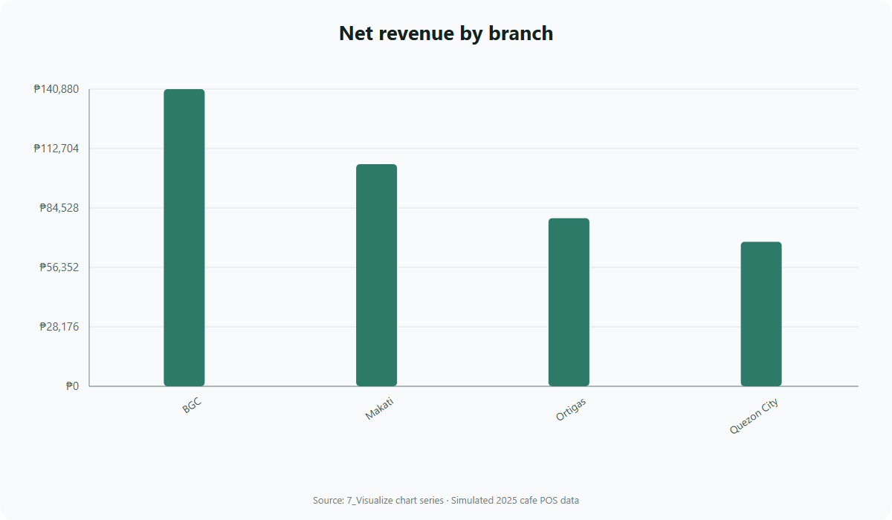
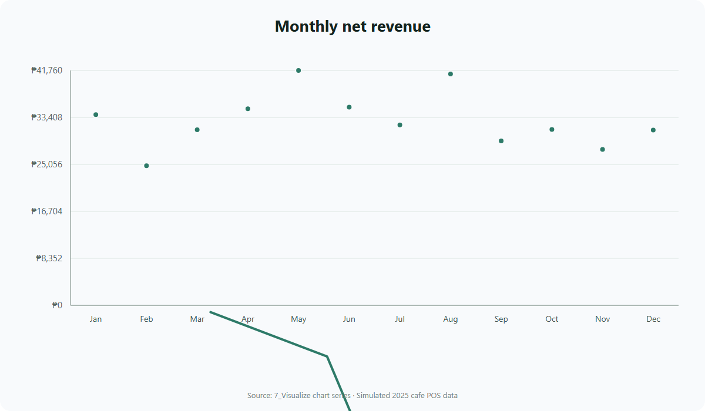
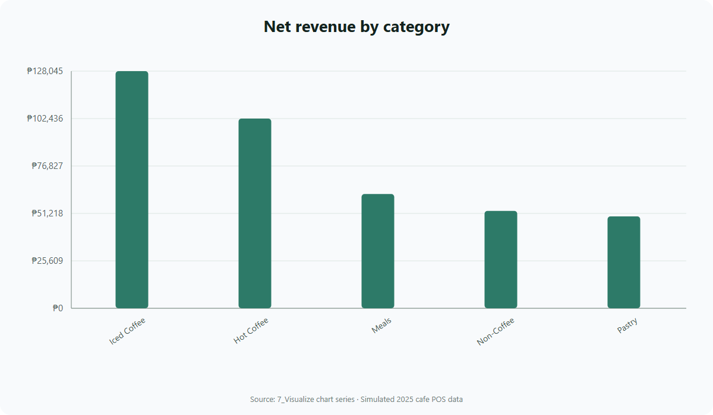
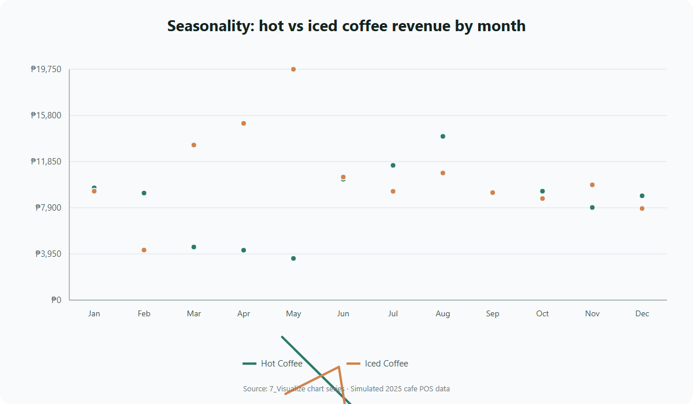
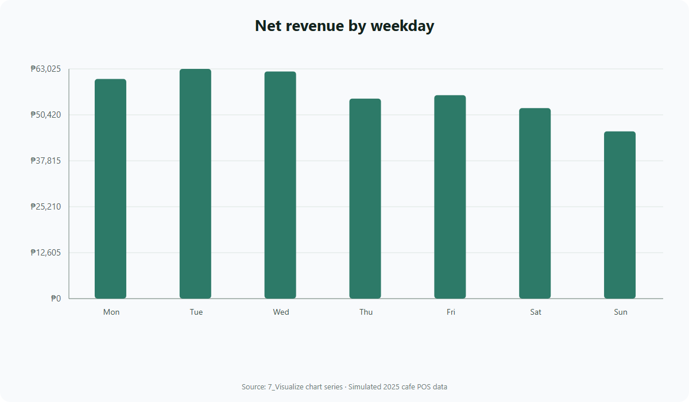
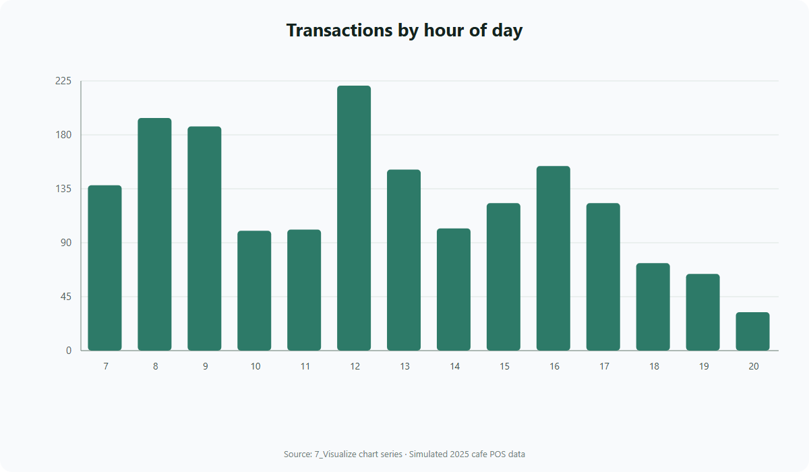
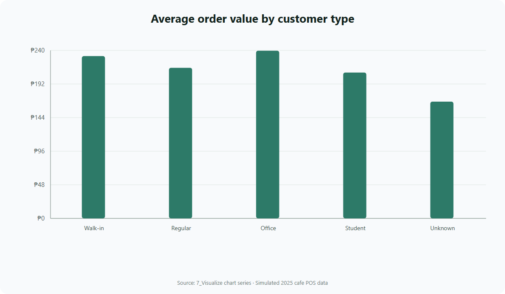
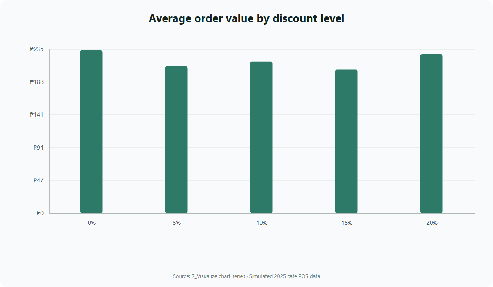

# Workbook Charts

These eight PNG images are rendered from the chart series in `dashboard/Cafe_Sales_Data_Analysis.xlsx` → `7_Visualize`. Category labels and values come from the workbook's embedded chart data. Matching SVG files are included for resolution-independent viewing. All data is simulated.

## Net revenue by branch

## Monthly net revenue

## Net revenue by category

## Hot vs iced coffee seasonality

## Net revenue by weekday

## Transactions by hour

## Average order value by customer type

## Average order value by discount level

`index.html` provides a local gallery of the chart images. The SVG versions are resolution-independent and can be zoomed without losing clarity.
